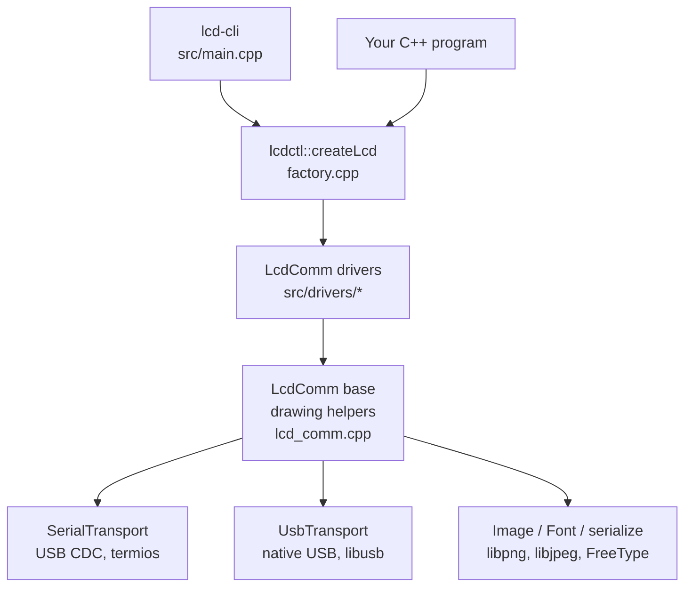
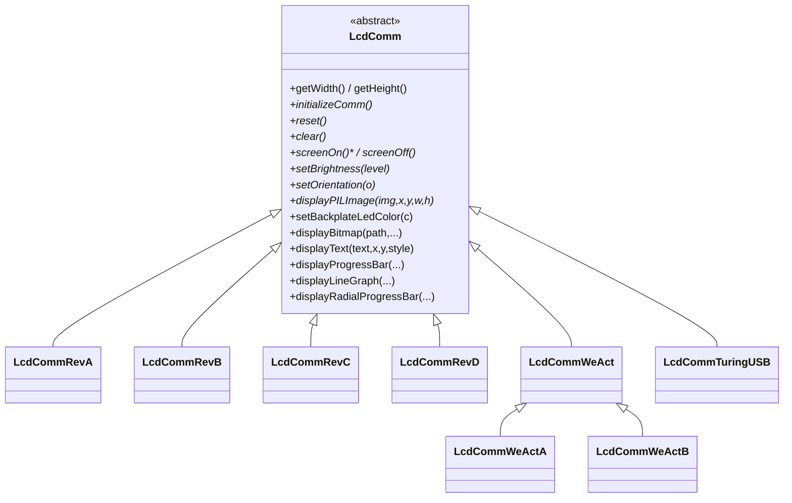
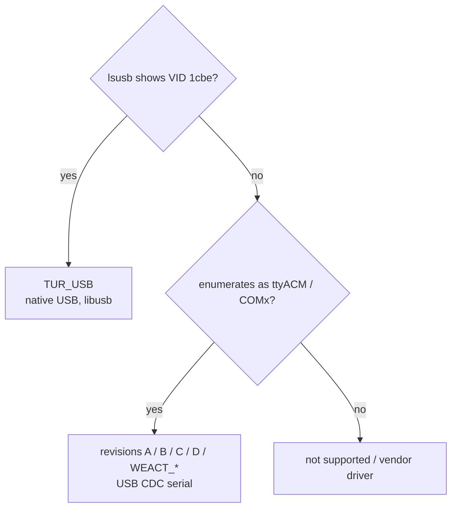
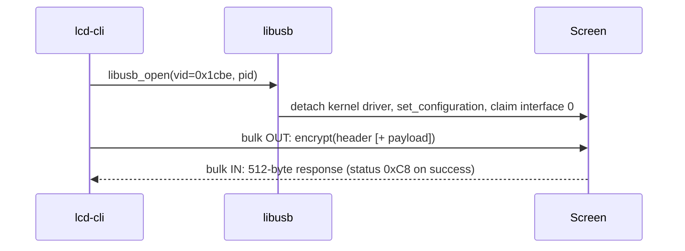
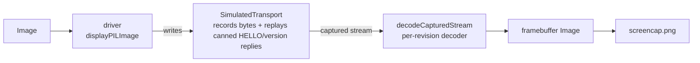

# Architecture

`USB-monitor-controller` is a C++17 port of the LCD subsystem of
[turing-smart-screen-python](https://github.com/mathoudebine/turing-smart-screen-python).
It keeps the layered design of the original — *transport → driver → drawing
helpers* — but drops everything related to sensors, stats, themes and
scheduling.

- [1. Layers](#1-layers)
- [2. Source layout](#2-source-layout)
- [3. The `LcdComm` abstraction](#3-the-lcdcomm-abstraction)
- [4. Transports](#4-transports)
- [5. USB wire protocols](#5-usb-wire-protocols)
- [6. Revision detection & factory](#6-revision-detection--factory)
- [7. Relationship to the Python project](#7-relationship-to-the-python-project)

---

## 1. Layers

Two ideas drive the design:

1. **Everything is bytes.** A driver only needs `write()`/`read()` from a
   `Transport`. The same code runs over a virtual serial port or a USB endpoint.
2. **One primitive, many helpers.** Each revision implements exactly one
   rendering method, `displayPILImage()`. Text, progress bars and graphs are
   built on top of it in the base class and are shared by every screen model.

---

## 2. Source layout

| Path | Role |
|------|------|
| `include/lcdctl/types.hpp` | `Orientation`, `Color`, `parseColor`, `parseOrientation`. |
| `include/lcdctl/image.hpp` | `Image`: an interleaved RGB/RGBA bitmap + crop/resize/rotate/paste. |
| `include/lcdctl/serialize.hpp` | RGB565 (LE/BE), BGR, BGRA, compressed BGRA, chunking. |
| `include/lcdctl/font.hpp` | FreeType wrapper: measure + draw text. |
| `include/lcdctl/transport.hpp` | `Transport`, `SerialTransport`, `UsbTransport`, enumeration. |
| `include/lcdctl/lcd_comm.hpp` | Abstract `LcdComm` + `TextStyle`/`RadialStyle` + drawing helpers. |
| `include/lcdctl/drivers.hpp` | One class per revision. |
| `include/lcdctl/factory.hpp` | `Revision`, detection, `createLcd()`. |
| `include/lcdctl/paths.hpp` | Locates the bundled `res/` directory and default font. |
| `include/lcdctl/simulate.hpp` | Offline simulation: recording transport + per-revision decoders. |
| `include/lcdctl/console.hpp`, `src/console.cpp` | Terminal-like scrolling text area (console / teleprompter). |
| `src/simulate.cpp` | Simulation transport, decoders for A/B/D/WeAct, simulated driver factory. |
| `src/simulate_rev_c.cpp` | Revision C decoder (0xef69 framing, full + partial updates). |
| `tests/simulate_roundtrip.cpp` | Round-trip self test (`lcd-selftest`). |
| `src/drivers/rev_a.cpp … turing_usb.cpp` | The per-revision protocol implementations. |
| `src/main.cpp` | The `lcd-cli` tool. |

---

## 3. The `LcdComm` abstraction

* `Orientation` is stored on the instance; `getWidth()`/`getHeight()` swap
  depending on it. Revisions that cannot rotate in hardware rotate the image in
  software.
* `imageCache_` / `fontCache_` avoid reloading files on every draw.
* `displayText()` composes a canvas (solid colour or a background image), draws
  with FreeType, crops to the text bounding box and forwards to
  `displayPILImage()`. Horizontal alignment (`left`/`center`/`right`) is applied
  before drawing.

> **Deviation from Python:** the original pushes every write into a global,
> mutex-protected `update_queue` drained by a worker thread, because the system
> monitor writes from many sensor threads. A controller library does not need
> that; here all writes are synchronous. If you call the library from several
> threads, serialize the calls yourself.

> **Deviation from Python (rev A `clear()`):** the upstream project clears with
> the native `CLEAR` command (102). Some rev. A controllers silently ignore it
> — the panel keeps showing the previous frame (observed on a UsbPCMonitor
> 3.5"). `LcdCommRevA::clear()` therefore repaints a blank full-screen bitmap,
> exactly like revisions B and C already do. `LcdComm::fillScreen(color)` is the
> generic helper behind it, and `lcd-cli clear --color <c>` can blank the screen
> in any colour.

`TextConsole` (`console.hpp`) builds a terminal-like area on top of
`displayPILImage()`: while it is still filling it draws only the new line (cheap,
one row); once full, adding a line shifts the content and redraws the whole area,
which is where the link budget matters (see `docs/FINDINGS.md` §2).

---

## 4. Transports

### `SerialTransport` (Linux/POSIX, `termios`)

* Opens `115200 8N1`, `CLOCAL|CREAD`, RTS/CTS enabled, retrying up to 10 times
  one second apart — screens often reset and re-enumerate just after a program
  starts, so the port can be missing for a few seconds.
* `read(len, timeoutMs)` uses `select()` for a real timeout (the file descriptor
  itself is blocking).
* `enumerate()` reads `/sys/class/tty/ttyACM*` and `/sys/class/tty/ttyUSB*` and
  resolves each one's USB `VID/PID/serial` from sysfs.

### `UsbTransport` (native USB, libusb)

* Finds the interface's first bulk OUT and bulk IN endpoints, detaches an active
  kernel driver (Linux), and performs bulk transfers.
* `readAll()` is a short-timeout read used to flush the IN endpoint.
* Compiled only when `LCDCTL_WITH_LIBUSB` is defined; otherwise
  `UsbTransport::available()` returns `false`.

---

## 5. USB wire protocols

### 5.1 Which transport?

### 5.2 USB CDC serial (A, B, C, D, WeAct)

All of these use `115200 8N1` with RTS/CTS. Only the framing and pixel format
differ:

| Rev | Command frame | Pixel format | Chunk |
|-----|---------------|--------------|-------|
| A | 6 bytes `x,y,ex,ey,cmd` | RGB565 **LE** | `width*8` bytes |
| B | 10 bytes `cmd p0..p7 cmd` | RGB565 **BE** | `width*8` bytes + 50 ms |
| C | `0xef69` framed, padded to 250 B | BGRA / BGR | 249-byte `\0`-joined blocks |
| D | `CMD + payload` (4-byte cmds) | RGB565 **BE** | 63 bytes, prefixed `0x50` |
| WeAct A/B | `CMD, payload…, 0x0A` | RGB565 **LE** | `width*4` bytes |

Brightness scaling also differs: rev A `255 − level%·255` (0 = brightest),
rev B `0..255` for range-capable units else `0/1`, rev C `level%·255`,
rev D `level·5` (0..500), WeAct `level%·255`, TUR_USB `level%·102`.

### 5.3 Native USB vendor protocol (TUR_USB)

* **VID** `0x1cbe`; the **PID** selects the resolution:
  `0x0028` 480×480, `0x0046` 320×960, `0x0050` 720×1280, `0x0080` 800×1280,
  `0x0088` 480×1920, `0x0092` 462×1920, `0x0123` 720×1920.
* **Header** (500 bytes): `[0]=cmd`, `[2..3]=0x1A 0x6D`, `[4..7]=ms since local
  midnight (LE)`, `[8..11]=payload length (BE)` for data uploads.
* **Encryption**: the header is DES-CBC encrypted with key = IV = `slv3tuzx`,
  zero-padded, then wrapped in a 512-byte packet with `[510]=161`, `[511]=26`.
* **Commands used here**: `10` sync, `14` brightness, `101` upload JPEG,
  `102` upload PNG.
* **Rendering**: the full screen is kept as one RGBA `currentState_`; each draw
  pastes onto it, the whole image is rotated back to portrait and sent as PNG,
  falling back to JPEG when it would exceed 1 MiB.

---

## 6. Revision detection & factory

`detectDevices()` returns every supported screen currently connected:

* native-USB models first (from `UsbTransport::enumerate()`), then
* serial screens, with a revision guessed from the USB identifiers:

| VID:PID | Serial / marker | Revision |
|---------|-----------------|----------|
| `1a86:5722` | `USB35INCHIPSV2` | `A` |
| `1a86:5722` | `2017-2-25` | `B` |
| `1a86:5722` / `1a86:ca21` | `USB7INCH`, `CT21INCH`, `CT88INCH` | `C` |
| `0525:a4a7`, `1d6b:0121`, `1d6b:0106` | `20080411` | `C` (awake) |
| `454d:4e41` | `MEAN PANEL` | `D` |
| `1a86:fe0c` | serial `AB…` / `AD…` | `WEACT_A` / `WEACT_B` |

`createLcd(revision, port, width, height)` then opens the port (auto-detecting it
if needed) and returns the matching driver as a `std::unique_ptr<LcdComm>`.

---

## 7. Offline simulation

Because the drivers are pure byte encoders, they can be tested with no hardware
by inverting them:

* `SimulatedTransport` records every write and replays the HELLO / version
  answers a real screen would return, so `initializeComm()` succeeds.
* `decodeCapturedStream()` parses the recorded stream back into pixels. Each
  decoder mirrors the framing of its encoder:
  * **A** — 6/16-byte packets; `DISPLAY_BITMAP` (197) sets a rectangle, then
    RGB565 LE data follows.
  * **B** — 10-byte frames; `0xCC` sets a rectangle, then RGB565 BE data.
  * **C** — messages padded to 250 bytes; full-image and partial-update paths,
    BGRA/BGR data, per-row index headers.
  * **D** — variable-length commands, `BLOCKWRITE` rectangle, then RGB565 BE
    data in 63-byte groups each prefixed with `0x50`.
  * **WeAct** — `CMD … CMD_END` frames; `SET_BITMAP` (0x05) sets a rectangle,
    then RGB565 LE data.
* `lcd-selftest` drives every revision with a pattern, decodes the result and
  asserts byte equality (using an orientation that avoids software rotation).

`TUR_USB` is intentionally not simulatable: it sends encrypted PNG/JPEG
payloads, so there is no simple framebuffer to decode.

## 8. Relationship to the Python project

| Python | C++ |
|--------|-----|
| `library/lcd/lcd_comm.py` | `lcd_comm.hpp` / `lcd_comm.cpp` |
| `library/lcd/lcd_comm_rev_a.py` … | `src/drivers/rev_a.cpp` … |
| `library/lcd/lcd_comm_turing_usb.py` | `src/drivers/turing_usb.cpp` |
| `library/lcd/serialize.py` | `serialize.hpp` / `serialize.cpp` |
| `library/lcd/color.py` | `types.cpp` (`parseColor`) |
| `library/lcd/lcd_simulated.py` | `simulate.hpp` / `simulate.cpp` (decode-to-PNG instead of a fake driver) |
| `library/display.py` (factory) | `factory.cpp` |
| Pillow `Image` / `ImageFont` | `image.cpp` (libpng/libjpeg) / `font.cpp` (FreeType) |
| `pyserial` | `SerialTransport` (termios) |
| `pyusb` | `UsbTransport` (libusb) |
| `pycryptodome` DES | OpenSSL EVP DES |
| `simple-program.py` | `lcd-cli` |
| `library/scheduler.py`, `stats.py`, `sensors/*`, `config.py` | **not ported** |

The wire protocols are reproduced byte-for-byte from the Python sources; each
driver file states which Python file it was ported from.
