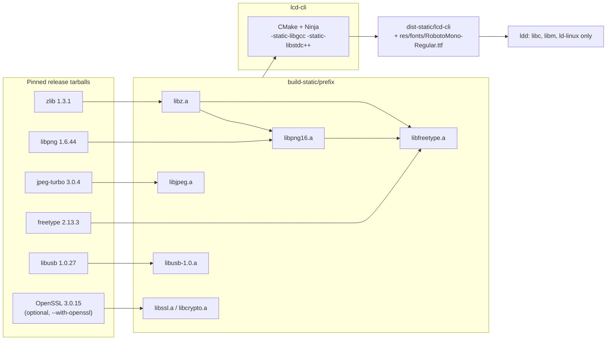

# Static / self-contained build of `lcd-cli`

`tools/build-static.sh` produces a **distributable** `lcd-cli` that does not
depend on the Homebrew shared libraries used by the normal development build.
It downloads pinned release tarballs, builds the third-party dependencies as
static archives in a local prefix, links the project against that prefix only,
and copies the result (plus the bundled font) to `dist-static/`.



## Why the binary is not *fully* static

A fully static (musl-style) binary would need static versions of **every**
dependency, including the C library. On the supported build host:

- Homebrew ships no static libraries (no `.a` archives), and
- there is no system `libc.a`,

so `-static` is not achievable. Instead:

| Component | Linkage |
|-----------|---------|
| zlib, libpng, jpeg-turbo, freetype, libusb (and OpenSSL with `--with-openssl`) | **static** (built from source) |
| `libstdc++`, `libgcc` | **static** (`-static-libstdc++ -static-libgcc`) |
| glibc (`libc`, `libm`, `ld-linux`) | **dynamic** (system) |

Linking glibc dynamically is normal and portable across Linux distributions of
the same architecture and a compatible glibc. The result has no
`/home/linuxbrew` dependency and no RPATH.

## Prerequisites

Build tools (Homebrew is the sanctioned package manager):

```sh
brew install cmake ninja pkg-config nasm curl
```

`nasm` is optional: without it jpeg-turbo is built without SIMD acceleration.
The script also needs `tar`, `make` and a C/C++ toolchain (`g++`). If the
system does not provide `libstdc++.a`, the script stages one from a Homebrew GCC
installation (or, as a last resort, extracts it from the distro
`libstdc++-static` package); this is build-time only.

## Usage

```sh
# Build everything (TUR_USB stays disabled: no static OpenSSL)
tools/build-static.sh

# Same, but also build OpenSSL statically so TUR_USB is compiled in
tools/build-static.sh --with-openssl

# Custom prefix / more jobs
tools/build-static.sh --prefix /opt/lcd-static -j 8

# Force a rebuild of the dependencies and the project
tools/build-static.sh --clean
```

The script is **idempotent**: every dependency is stamped in
`build-static/prefix/.stamp-<name>-<version>`, so a re-run reuses the existing
prefix and only rebuilds the project. `--clean` removes the prefix and the
intermediate build trees (downloaded tarballs are kept in
`build-static/downloads/` so they are not fetched again).

### Options

| Option | Meaning |
|--------|---------|
| `--prefix DIR` | where the static dependencies are installed (default `build-static/prefix`) |
| `--with-openssl` | also build OpenSSL statically (enables the `TUR_USB` revision; slow) |
| `--clean` | wipe the prefix/build trees before building |
| `-j`, `--jobs N` | parallel build jobs (default: number of CPUs) |
| `-h`, `--help` | show usage |

## What the script does

1. Downloads and SHA-256-verifies the pinned tarballs into
   `build-static/downloads/`.
2. Builds them in dependency order:
   **zlib → libpng → jpeg-turbo → freetype → libusb** (and OpenSSL last when
   requested), installing only static archives into the prefix.
   - freetype is configured with `--without-harfbuzz --without-brotli
     --without-bzip2` to keep the dependency tree minimal.
   - libusb is configured with `--disable-udev`; a static `libudev` does not
     exist on the host and the sysfs/devfs fallback enumerates the screens.
3. Configures the project with an isolated `PKG_CONFIG_PATH`/`PKG_CONFIG_LIBDIR`
   pointing **only** at the static prefix, and a pkg-config wrapper that adds
   `--static` (so private dependencies such as `-lz` are linked too).
4. Links with:

   ```sh
   -DCMAKE_BUILD_TYPE=Release \
   -DCMAKE_EXE_LINKER_FLAGS="-static-libgcc -static-libstdc++" \
   -DLCDCTL_BUILD_TESTS=OFF
   ```

5. Copies `lcd-cli` to `dist-static/lcd-cli` (stripped of debug information) and
   the default font to `dist-static/res/fonts/RobotoMono-Regular.ttf`.
6. Prints a verification report: `ldd` (must contain no Homebrew paths) and the
   output of `lcd-cli list` and `lcd-cli --help`.

## Output layout

```
dist-static/
├── lcd-cli
└── res/
    └── fonts/
        └── RobotoMono-Regular.ttf
```

Ship the whole `dist-static/` directory: the font is looked up relative to the
executable (`<exe>/res/fonts/RobotoMono-Regular.ttf`).

## Verification

```sh
ldd dist-static/lcd-cli            # only libc/libm/ld-linux, no linuxbrew
dist-static/lcd-cli list           # lists the serial and native-USB screens
dist-static/lcd-cli --help         # prints the usage
```

Expected `ldd` output (architecture/loader may vary):

```
linux-vdso.so.1
libm.so.6 => /usr/lib64/libm.so.6
libc.so.6 => /usr/lib64/libc.so.6
/lib64/ld-linux-x86-64.so.2
```

## Known limits

- **glibc remains dynamic.** The binary is portable across distributions of the
  same architecture with a compatible glibc, but it is not a single-file
  no-OS-dependency binary.
- **`TUR_USB` is disabled by default.** The CMake project only enables it when
  both libusb and OpenSSL are found. OpenSSL static is slow to build, so it is
  opt-in via `--with-openssl`.
- **No libusb hotplug events.** libusb is built with udev disabled; device
  *enumeration* works, but hotplug notifications are not available. Re-run
  `lcd-cli list` after plugging a device.
- **No cross-compilation.** The script builds for the host architecture using
  the host toolchain.
- **Font is a separate file.** `lcd-cli text` needs
  `res/fonts/RobotoMono-Regular.ttf` next to the binary unless `--font` is
  passed.
- **Download cache is not cleaned** by `--clean`; remove
  `build-static/downloads/` manually if needed.

## Repository hygiene

The result directories are build artifacts:

```
build-static/
dist-static/
```

They are ignored by the repository's `.gitignore` (both lines are present). If
you build in a checkout that does not ignore them yet, add them; the script
prints a warning listing any artifact directory that `git status` would show.

## Pinned versions

| Dependency | Version | URL |
|------------|---------|-----|
| zlib | 1.3.1 | `https://zlib.net/fossils/zlib-1.3.1.tar.gz` |
| libpng | 1.6.44 | `https://download.sourceforge.net/libpng/libpng-1.6.44.tar.xz` |
| jpeg-turbo | 3.0.4 | `https://github.com/libjpeg-turbo/libjpeg-turbo/releases/download/3.0.4/...` |
| freetype | 2.13.3 | `https://download.savannah.gnu.org/releases/freetype/freetype-2.13.3.tar.xz` |
| libusb | 1.0.27 | `https://github.com/libusb/libusb/releases/download/v1.0.27/...` |
| OpenSSL | 3.0.15 | `https://www.openssl.org/source/openssl-3.0.15.tar.gz` |

Each download is verified against a SHA-256 digest recorded in the script.

## Troubleshooting

| Symptom | Fix |
|---------|-----|
| `no static libstdc++ found` | Install `libstdc++-static` (distro) or a Homebrew GCC (`brew install gcc`) |
| `Package 'openssl' not found` during configure | Expected without `--with-openssl`; `TUR_USB` is then disabled |
| Configure picks a Homebrew `.so` | Make sure no stale `PKG_CONFIG_PATH` is exported; the script overrides it |
| `ldd` shows `libstdc++.so` | The static runtime was not staged; check the "static C++ runtime" log line |
| Runtime error `libssl.so.*: cannot open shared object file` | A CMake cache from an earlier `--with-openssl` run was reused. The project build tree is now keyed on the prefix and configured with `--fresh`; re-run `tools/build-static.sh --clean` |
| Device not listed | Check permissions (`dialout`/`uucp` group) and that the device is not claimed by `brltty`/`ModemManager` |
