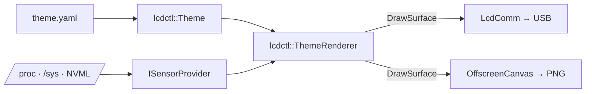

# Themes, sensors and the monitor daemon

`USB-monitor-controller` ships the three missing pieces of the Python project
that turned the LCD into a system monitor:

| Piece | Binary / API | Replaces |
|---|---|---|
| Theme model + renderer | `lcdctl::Theme`, `lcdctl::ThemeRenderer` | `library/stats.py`, `library/display.py` |
| Metrics | `lcdctl::SensorProvider` (`makeLinuxSensors`, `makeStaticSensors`, `makeRandomSensors`) | `library/sensors/*` (psutil, GPUtil, LHM) |
| Scheduler / daemon | `lcdctl::MonitorEngine`, `lcd-monitor` | `library/scheduler.py`, `main.py` |
| Theme tools | `lcd-theme` (list/show/validate/preview) | `configure.py` theme selection |
| Visual editor | `lcd-theme-editor` (Qt6) | `theme-editor.py` |

Nothing is converted: **the `res/themes/<name>/theme.yaml` files of the Python
project are read as-is**, and the bundled theme is plain GPL data.



## 1. Quick start

```sh
make                                  # build everything (needs brew yaml-cpp)
./build/lcd-theme list                # themes found in build/res/themes
./build/lcd-theme preview demo-320x480 -o preview.png
./build/lcd-theme preview 3.5inchTheme2 --rotate-output 180 -o mounted.png
./build/lcd-theme preview 3.5inchTheme2 --orientation landscape   # warns: cropped
./build/lcd-monitor --once            # one sample, JSON on stdout
./build/lcd-monitor                   # tray icon (KDE), drives the screen
./build/lcd-monitor --headless        # no tray (systemd, ssh)
./build/lcd-theme-editor build/res/themes build/res/fonts demo-320x480
```

**32 themes are bundled** (`res/themes/`): the 31 upstream themes whose
background is 320x480 — the resolution of the validated hardware — plus
`demo-320x480` written for this project. Import other resolutions with
`tools/import-themes.py` (see `res/themes/README.md`). To reuse the complete
upstream collection without copying anything, point the tools at a checkout:

```sh
./build/lcd-theme list  --root ~/src/turing-smart-screen-python/res/themes \
                        --fonts ~/src/turing-smart-screen-python/res/fonts
```

or set it once in `config.yaml`:

```yaml
app:
  THEME_ROOT: ~/src/turing-smart-screen-python/res/themes
  FONTS_DIR:  ~/src/turing-smart-screen-python/res/fonts
```

Environment variables `LCDCTL_THEME_ROOT` / `LCDCTL_FONTS_DIR` /
`LCDCTL_EXTRA_FONTS` (colon-separated) do the same without a config file.

## 2. `theme.yaml` support

Supported sections:

- `display`: `DISPLAY_ORIENTATION`, `DISPLAY_SIZE`, `DISPLAY_RGB_LED`
- `static_images`: `PATH`, `X`, `Y`, `WIDTH`, `HEIGHT`
- `static_text`: `TEXT`, `X`, `Y`, `WIDTH`, `HEIGHT`, `FONT`, `FONT_SIZE`,
  `FONT_COLOR`, `BACKGROUND_COLOR`, `BACKGROUND_IMAGE`, `ALIGN`,
  `ANCHOR` (`lt`, `lm`, `mm`, `rt`, `mb`, `la`…)
- `STATS`:
  - `CPU`: `PERCENTAGE`, `FREQUENCY`, `LOAD` (ONE/FIVE/FIFTEEN),
    `TEMPERATURE`, `FAN_SPEED`
  - `GPU`: `PERCENTAGE`, `MEMORY` (absolute MB), `MEMORY_PERCENT`,
    `TEMPERATURE`, `FREQUENCY`, `FAN_SPEED`, `FPS`, `FORMATTED`
  - `MEMORY`: `VIRTUAL` / `SWAP` with `PERCENT_TEXT`, `USED`, `FREE`, `TOTAL`
  - `DISK`: `USED` (`GRAPH`, `TEXT` in bytes, `PERCENT_TEXT`), `FREE`, `TOTAL`,
    `MOUNT_POINT`
  - `NET`: `ETH` / `WLO` with `UPLOAD`, `DOWNLOAD` (rate), `UPLOADED`,
    `DOWNLOADED` (totals)
  - `DATE` (`DAY`, `HOUR` with `FORMAT: short|medium|long|full`), `UPTIME`
  - `CUSTOM` (`TEXT`, `GRAPH`, `RADIAL`, `LINE_GRAPH`)
  - Views: `TEXT`, `GRAPH` (progress bar), `RADIAL`, `LINE_GRAPH`
  - `INTERVAL` (seconds) is read on the view, then on its section

Not supported yet (reported by `lcd-theme validate`/`show`, ignored at render
time): `STATS/WEATHER`, `STATS/PING`, `RADIAL/BAR_DECORATION`,
`RADIAL/CUSTOM_BBOX`, `TEXT/ROTATION`.

Formatting is byte-compatible with `library/stats.py`:

| Metric | Format |
|---|---|
| percentages | integer, `MIN_SIZE` padding, `%` |
| temperatures | integer + `°C` |
| CPU/GPU frequency | `2.40 GHz` |
| memory used/free/total | megabytes, ` M` |
| disk used/free/total | gigabytes (`/1e9`), ` G` |
| network rates | `1.2 M/s` (psutil `bytes2human`) |
| uptime | `4 days, 16:47:16` |

## 3. Sensors

| Metric | Source |
|---|---|
| CPU % | `/proc/stat` delta |
| CPU frequency | `cpufreq/scaling_cur_freq` (average), fallback `/proc/cpuinfo` |
| CPU load | `/proc/loadavg` (normalised by core count) |
| CPU temperature | `/sys/class/hwmon` (`coretemp`, `k10temp`, `zenpower`, `acpitz`…) |
| CPU fan | `/sys/class/hwmon/*/fan*_input` (`CPU_FAN: AUTO` or `chip/fan2`) |
| GPU | NVML via `dlopen` (NVIDIA), then AMD `gpu_busy_percent` / `mem_info_vram_*` |
| Memory | `/proc/meminfo` (`used = total − available`) |
| Disk | `statvfs()` on `DISK_MOUNT` (empty ⇒ the filesystem holding `$HOME`) |
| Network | `/proc/net/dev` delta; interface auto-detected from `/proc/net/route` |
| Date/hour | `strftime`, locale-aware |
| Uptime | `/proc/uptime` |
| Custom | `app.CUSTOM_SENSORS.<name>: "<shell command>"` (first line, 500 ms timeout) |

`HW_SENSORS` accepts `AUTO`/`LINUX` (real), `STATIC` (fixed values, same as
`sensors_stub_static.py`), `RANDOM`, and `--stub static:cpu=42,gpu=12` on the
command line for previews and tests.

## 4. Throughput and partial updates

The engine never sends a full frame twice:

1. the background (`static_images` + `static_text`) is sent once;
2. each theme item is drawn in its own small rectangle;
3. an item is only transmitted when its rendered text (or bar value) changes.

That is what makes the revision A usable (~122 kB/s ⇒ ~2.4 s for a 320×480
frame): a percentage text is ~40×20 px, a bar ~150×16 px. `lcd-monitor` prints
nothing per frame; `MonitorEngine::framePixels()` gives the worst-case cost, and
`screencap`-style measurements belong in `docs/FINDINGS.md`.

## 5. Daemon details

- One render thread owns the transport: `lcd-monitor --tray` runs the engine in
  a `QThread` and the GUI only sends it commands (queued), so the menus and the
  window answer immediately even while a 2.4 s frame is being sent. `--headless`
  runs the same loop on the main thread.
- Sensors are sampled in the same thread (procfs reads are cheap; NVML is
  ~1 ms). A due item triggers one sample, at most every 200 ms.
- `SIGINT`/`SIGTERM` → last tick, `screenOff()`, exit 0.
- Transport errors → reopen after 3 s (revision A resets and may renumber
  `/dev/ttyACM0`), then redraw everything.
- `--tray` (default when a display is available): KDE/XDG tray icon with screen
  on/off, brightness, **Orientation**, theme switch, **Edit theme…**,
  **Start at login**, Quit. Clicking the icon opens the editor.
- **Orientation**: the theme fixes the layout aspect (portrait or landscape),
  the user chooses which side of the panel is up. The tray offers the four
  rotations; the 180° flip is native on rev A. A 90°/270° rotation changes the
  canvas size and is refused (with a warning) unless `FORCE_ORIENTATION` is set
  or `--force-orientation` is passed — it crops a theme drawn for the other
  aspect. Persisted as `display.DISPLAY_ORIENTATION`
  (`AUTO` = follow the theme; `DISPLAY_REVERSE: true` still flips 180°).
- `Start at login` writes `~/.config/autostart/usb-monitor-controller.desktop`
  (`Exec=<binary> --tray`, `X-KDE-autostart-after=panel`).

### systemd (no desktop session)

`tools/systemd/lcd-monitor.service`:

```sh
make
sudo install -m 644 tools/systemd/lcd-monitor.service /etc/systemd/system/
sudo install -m 755 build/lcd-monitor /usr/local/bin/
sudo systemctl enable --now lcd-monitor
```

## 6. Editor

`lcd-theme-editor [themes-root] [fonts-root] [theme]`:

- item list (hidden items greyed out) and static-text list;
- live preview rendered by the **same** `ThemeRenderer` as the daemon, so the
  pixels are the transmitted pixels;
- drag an item on the canvas, or edit X/Y/WIDTH/HEIGHT/FONT_SIZE/ANCHOR/INTERVAL;
- **Layout** switches the theme between portrait and landscape;
  **Preview rotation** (0/90/180/270) turns the *preview only*, to check what the
  eye sees when the panel is mounted that way;
- `Save` writes `theme.yaml` and keeps `theme.yaml.bak`.

Known limitation: `yaml-cpp` drops comments on save. The `.bak` file keeps the
previous version, and `git diff` shows the structural change.

## 7. Importing images (themes, fonts, icons)

`tools/import-themes.py` copies themes, the font families they use and (on
request) `res/icons/` from a `turing-smart-screen-python` checkout:

```sh
tools/import-themes.py --dry-run                  # what 320x480 would copy
tools/import-themes.py                            # bundled set (default)
tools/import-themes.py --size 480x800 --size 800x480
tools/import-themes.py --all --icons              # everything (~75 MB)
tools/import-themes.py --fonts none               # keep using an external font root
```

Only `.ttf`/`.otf` + licence files are copied for fonts (the upstream preview
PNGs are unused), and `res/themes/demo-320x480` is never overwritten. The
bundled `res/icons/monitor-icon-17865/64.png` is used as the tray icon and as
the `Icon=` of the autostart entry.

## 8. Tests

```sh
make test                                             # ctest: 2 suites
LCDCTL_TEST_THEMES=~/src/turing-smart-screen-python/res/themes \
LCDCTL_TEST_FONTS=~/src/turing-smart-screen-python/res/fonts \
  ./build/lcd-theme-selftest                          # renders all 73 themes
```

`tests/theme_selftest.cpp` covers: psutil-compatible byte formatting, static
sensor values, theme parsing, determinism of a render, "unchanged value is not
retransmitted", text ghosting when a value shrinks, YAML round-trip, and the
whole upstream theme collection.
