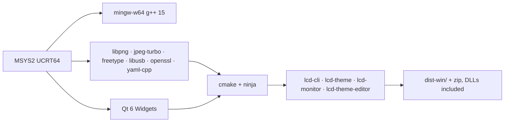

# Windows build

`USB-monitor-controller` builds natively on Windows 10/11 with **MSYS2
(UCRT64)** and **Qt 6**. Everything except the temperature/fan sensors, which
need an external provider, works the same as on Linux.

Validated on Windows 10 22H2 (19045) inside QEMU/KVM: build, `lcd-theme-selftest`
(58 checks), `lcd-selftest` (14 protocol round-trips), theme preview and the Qt
editor. The serial transport was compiled and enumerates through SetupAPI, but
no screen could be plugged into that VM: **driving a real panel from Windows is
not yet confirmed on hardware.**



## 1. Prerequisites

Install [MSYS2](https://www.msys2.org/), then in the **UCRT64** shell:

```sh
pacman -Syu --noconfirm
pacman -S --needed mingw-w64-ucrt-x86_64-{gcc,cmake,ninja,pkgconf,qt6-base,libpng,libjpeg-turbo,freetype,libusb,openssl,yaml-cpp}
```

MSYS2 is also what the CI/VM path uses: extract
`msys2-base-x86_64-latest.tar` on `C:\` (the `.tar.xz` needs an external `xz`
on Windows, the plain `.tar` works with the built-in `tar.exe`).

## 2. Build and package

```sh
cd /c/src/usb-monitor-controller
tools/build-windows.sh
```

The script configures `build-win/`, builds, runs both self tests, then produces:

- `dist-win/` — portable folder: executables, `res/` (fonts, themes, icons),
  Qt runtime + `platforms/qwindows.dll` (and `qoffscreen.dll`), MinGW DLLs and
  the third-party DLLs actually used;
- `usb-monitor-controller-windows-x64.zip` — the same folder, zipped.

Run it:

```
dist-win\lcd-monitor.exe --tray        # tray icon, drives the screen
dist-win\lcd-theme-editor.exe          # theme editor
dist-win\lcd-theme.exe preview demo-320x480 -o preview.png
```

Manual build, without the script:

```sh
cmake -S . -B build-win -G Ninja -DCMAKE_BUILD_TYPE=Release -DCMAKE_PREFIX_PATH=/ucrt64
cmake --build build-win -j 8
```

## 3. Windows-specific behaviour

| Topic | Linux | Windows |
|---|---|---|
| Serial port | `/dev/ttyACM0` (termios) | `COM3` (Win32 comm API, `\\.\COM3`) |
| Port list | sysfs (`ttyACM*`, `ttyUSB*`) | SetupAPI `GUID_DEVINTERFACE_COMPORT`, VID/PID parsed from the hardware id |
| CPU % | `/proc/stat` | `GetSystemTimes` |
| CPU MHz | `cpufreq` | registry `~MHz` |
| Load 1/5/15 | `/proc/loadavg` | exponentially smoothed CPU % (no loadavg on Windows) |
| RAM | `/proc/meminfo` | `GlobalMemoryStatusEx` |
| Disk | `statvfs($HOME)` | `GetDiskFreeSpaceExW`, drive from `DISK_MOUNT` or the system drive |
| Network | `/proc/net/dev` | `GetAdaptersAddresses` + `GetIfEntry` (32-bit counters, wrap handled) |
| GPU | NVML / AMD sysfs | NVML (`nvml.dll`) |
| Temperature / fan | hwmon | **LibreHardwareMonitor** at `http://127.0.0.1:8085` if running, otherwise displayed as `--` |
| Autostart | `~/.config/autostart/*.desktop` | `HKCU\Software\Microsoft\Windows\CurrentVersion\Run` |
| Config | `~/.config/usb-monitor-controller/config.yaml` | `%APPDATA%\usb-monitor-controller\config.yaml` |

For temperatures, install
[LibreHardwareMonitor](https://github.com/LibreHardwareMonitor/LibreHardwareMonitor),
enable *Options → Remote Web Server → Run* (port 8085). This is the same
provider the Python project uses on Windows.

## 4. Known limitations

- No hardware validation of the serial link under Windows (the VM had no USB
  screen passthrough). `lcd-cli list` runs and returns nothing without a device.
- The tray icon and the editor are Qt widgets: they were verified by rendering
  offscreen (`--screenshot`) in the VM, not by clicking in a live session.
- Temperatures and fan speeds require LibreHardwareMonitor; GPU metrics require
  an NVIDIA card (NVML).
- Native USB (`TUR_USB`) uses libusb: it builds and links, but the WinUSB driver
  must be bound to the device with Zadig on a real machine.

## 5. Cross-checking from Linux

The Windows binary cannot be run here, but the protocol encoders are covered by
`lcd-selftest`, which the Windows build runs too (14 checks, all passing in the
VM). Theme rendering on Windows was compared with the Linux previews through the
editor screenshot (`Cyberpunk`, same pixels).
